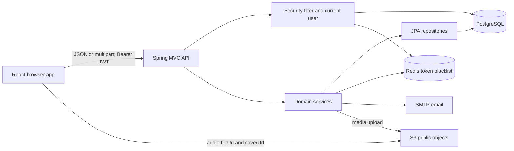
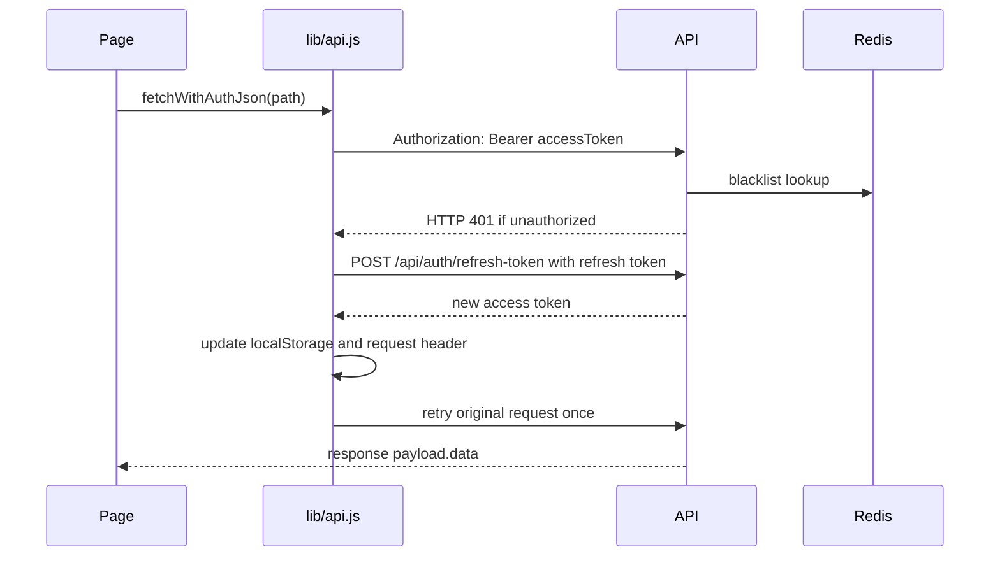

# Architecture and data flows

[Documentation index](README.md)

**Frontend update:** the backend flows below remain applicable, but the redesigned player now owns an explicit collection queue through MusicContext, starts playback on selection, and has no fabricated sample fallback. See [current playback contract](14-frontend-redesign.md). The original frontend walkthrough below is retained as baseline history.

## System structure

The browser fetches metadata through the API and streams audio directly from the returned URL. There is no inspected backend audio streaming endpoint, transcoding worker, signed media delivery layer, or websocket subscription.

The API follows controller → service → repository, with explicit DTO mapping before responses leave the service. Mapping is not entirely pure: `MusicMapper.toSongResponse` executes a distinct-listener query for each song. Album and playlist responses also load child songs, so response construction can cause many database queries.

## Browser lifecycle

`main.jsx` mounts `App`; `App` installs `BrowserRouter`, `AppRoutes`, and a global Sonner toaster. Public routes render landing/login/signup. `ProtectedRoute` checks only whether an access token exists in localStorage. Under `/music`, `MusicLayout` mounts `MusicProvider`, `AppHeader`, `SidebarApp`, the active route outlet, and `MusicPlay`. The provider survives navigation among music child routes and unmounts when leaving that layout. Admin pages have a separate layout and do not share this music player instance.

There is no central authentication context or global query cache. Pages and shared layout components independently request data. Favorite state and fetched catalog results can differ between pages until refetched.

## Authenticated request and refresh

Concurrent refresh requests in the same JavaScript module share `refreshTokenPromise`. This is not cross-tab synchronization. Refresh happens only for authenticated helper calls receiving HTTP 401; an HTTP 403 or an application-level `code` inside HTTP 200 does not trigger refresh. Refresh failure or retry HTTP 401 clears stored tokens; the helper does not itself redirect the browser.

## Song selection, playback, and statistics

1. A page calls context `setCurrentSong(song)`.
2. The provider sets selected state and asynchronously posts `{songId}` to history. Failure is logged without blocking selection.
3. The player builds a queue from the selected song followed by provider songs excluding the selected ID. Provider songs come from a trending fetch, not the entire current page or playlist.
4. The `<audio>` source is set to `fileUrl` or legacy `url`. Selecting a song does not itself set `isPlaying=true`.
5. Browser metadata/time events update the seek display. Volume changes write to the audio element.
6. Separately, `useListenTracker` updates localStorage after playback position reaches 30 seconds or half the duration, with a ten-minute per-song suppression window. It never posts to the backend.

Consequently server history records selection, not proven listening duration. Trending counts history rows; listenerCount counts distinct users in those rows; browser `listen-count` is a third metric. Deleting history changes both backend-derived metrics.

## Multipart upload

1. Browser posts multipart form fields to `POST /api/songs`.
2. The service resolves the current user and uploads audio, then optional cover, to S3.
3. S3 object keys contain a prefix, generated UUID, and original filename. Objects request `PUBLIC_READ` ACL.
4. The service saves a Song containing URLs, then saves an Upload with status `PENDING` and references to user and song.
5. The response contains SongResponse, not UploadResponse.
6. Public catalog queries can return the song immediately because reads do not join/filter upload status.

S3 writes and database writes are not a single transaction. A later failure can leave an S3 object or song without the corresponding completed upload record. Deleting a song does not delete media objects.

## Ownership and derived data

Personal favorites, follow relationships, playlists, history, and uploads use the current authenticated user's database ID. Playlist mutations require owner equality. Reading a private playlist requires ownership; reading public detail still passes through an authenticated URL rule. History deletion checks ownership. Administrative-looking `/api/users/{id}` and upload moderation methods have no equivalent explicit role checks in the inspected services; see security gaps.
