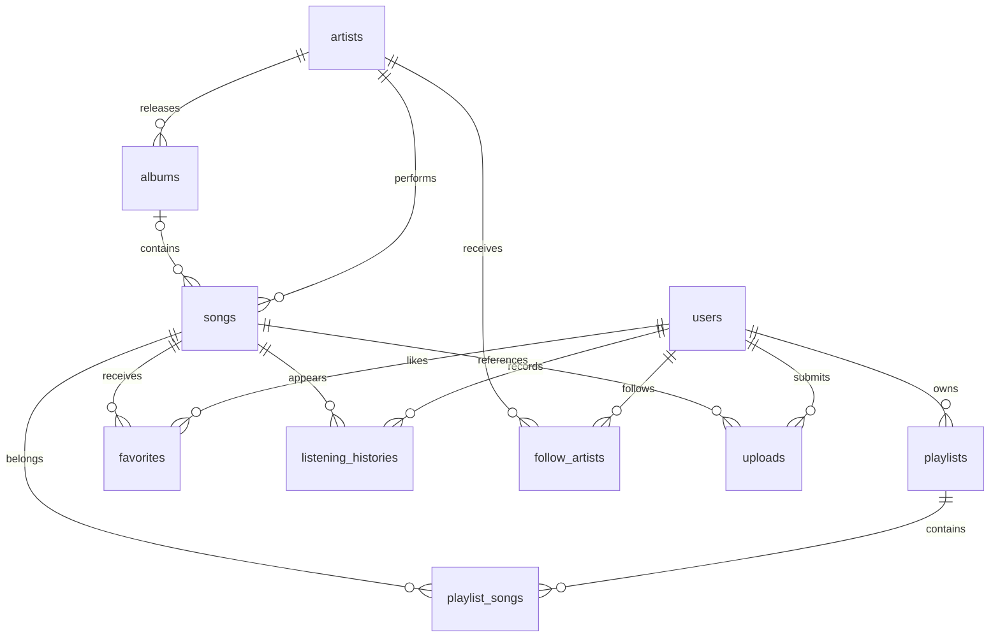

# Database reference

[Documentation index](README.md)

## Storage model

PostgreSQL holds catalog and user relationships; S3 holds media bytes; Redis holds short-lived authentication state. UUIDs are Java-generated with `GenerationType.UUID` for ordinary entities. Join entities use composite UUID keys with EmbeddedId and MapsId. Java LocalDate/LocalDateTime values are used without an explicit application timezone policy.

The diagram expresses domain relationships, not a guarantee that every foreign key is non-null. Several JPA relations have no `nullable=false` declaration.

## Entity dictionary

| Table / Java entity | Key | Fields and relationships |
| --- | --- | --- |
| users / User | id UUID | username required unique max 50; email required unique max 100; password required BCrypt hash; role required string enum USER/CREATOR/ADMIN; status required ACTIVE/BANNED default ACTIVE; createdAt required |
| artists / Artist | id UUID | name required; bio; avatarUrl; createdAt |
| albums / Album | id UUID | name required; artist_id → artists; releaseDate LocalDate; coverUrl |
| songs / Song | id UUID | title required; artist_id → artists; album_id → albums; duration int seconds; fileUrl and coverUrl text in JPA; createdAt |
| playlists / Playlist | id UUID | user_id → users; name required; isPublic boolean; createdAt |
| playlist_songs / PlaylistSong | playlist_id + song_id | MapsId references to playlists and songs; no order/added timestamp |
| favorites / Favorite | user_id + song_id | MapsId references to users and songs; no persisted addedAt |
| follow_artists / FollowArtist | user_id + artist_id | MapsId references to users and artists; no followed timestamp |
| listening_histories / ListeningHistory | id UUID | user_id → users; song_id → songs; listenedAt; repeated rows allowed |
| uploads / Upload | id UUID | user_id → users; song_id → songs; status String; createdAt; no rejection reason or reviewer |

Default JPA physical column naming maps camelCase fields to snake_case. Read actual schema before adding a migration: annotations and the checked-in SQL dump can differ, including URL varchar/text definitions. No JPA entity contains lyrics, genre, subscription, notification, password-reset token, playlist description, or media owner field on Song.

## Constraints and integrity

The checked-in dump defines primary keys, unique username/email constraints, role/status checks, and foreign keys. Its foreign keys do not declare ON DELETE CASCADE. The three join tables naturally prevent duplicate relationships through composite primary keys. Service existence checks improve idempotency but do not eliminate races between concurrent requests; database constraints remain decisive.

A song can be associated with any existing artist and album; SongService does not verify album.artist matches song.artist. Song has no direct uploader ownership column; upload ownership lives on Upload. Upload status is a free-form string in the entity, although services write PENDING/APPROVED/REJECTED.

## SQL files and initialization

- `src/main/resources/schema.sql` is a PostgreSQL 16.13 pg_dump containing both structure and COPY data, plus psql-specific commands. Root Compose mounts it into the first-start initialization directory. It is not a Flyway/Liquibase migration and should not be sent through a generic JDBC statement runner.
- `schema_1.sql` is a manual bootstrap script including role creation and extensions (`unaccent`, uuid-ossp). It is not selected by the root Compose mount and is not a safe incremental migration for an existing database.
- JPA defaults to `ddl-auto:update`. Both dev/prod profiles hardcode update. This does not provide reviewed, reversible schema history or install PostgreSQL extensions.
- No Flyway or Liquibase dependency/migration directory was found in the inspected source tree.
- Old H2 files under `data/` do not establish current PostgreSQL state.

The dump enables uuid-ossp but does not create unaccent. Search queries need `CREATE EXTENSION IF NOT EXISTS unaccent;` in the target database. Installation permissions must be handled by the database owner/operator.

## Derived fields and query semantics

| Exposed value | Calculation | Consequence |
| --- | --- | --- |
| Song.listenerCount | COUNT(DISTINCT history.user_id) for song | Not total plays; deleting history can reduce it |
| Trending order | COUNT(history.id) descending, song.created_at descending | Repeated selections affect ranking; no time window |
| Admin.totalListens | Total history row count | Clears/deletions reduce historical total |
| Artist.followerCount | Count follow_artists by artist | Derived rather than stored counter |
| Artist.songCount | Total from a one-item paged artist-song query | Can count songs regardless of upload state |
| Album.totalSongs/totalDuration | Size/sum of first 100 songs loaded | Incomplete for albums larger than 100 songs |
| Playlist.songCount | Size of fetched membership list | List responses embed full membership songs |
| Favorite.addedAt | LocalDateTime.now during response mapping | Not the original time of liking |

## Redis key dictionary

| Key prefix | Value | Lifetime |
| --- | --- | --- |
| auth:register:otp:<normalized-email> | Six-character OTP | 300 seconds |
| auth:register:otp:cooldown:<normalized-email> | 1 | 60 seconds |
| auth:login:otp:<normalized-email> | Six-character OTP | 300 seconds |
| auth:login:otp:cooldown:<normalized-email> | 1 | 60 seconds |
| blacklist:token:<raw-token> | 1 | Remaining token validity, milliseconds converted to Duration |

Redis is not the persistent source for playlists, favorites, or listening metrics. OTP cleanup occurs on successful register/login verification. Wrapper errors can silently prevent key writes/deletes or make blacklist checks return false.

## Schema change procedure

1. Inspect the current database and back it up; a source dump does not prove live structure.
2. Choose a migration approach and add an incremental migration with explicit constraints/indexes and data backfill as needed.
3. Update entity, request/response DTOs, service mapping, and native queries together.
4. Update frontend field readers and forms; verify nullable values and older rows.
5. Check every deletion path and existing FK references. For new timestamps or moderation state, define a backfill rule rather than inventing historical values.
6. Verify on a disposable database, including accent search and pagination; update this dictionary and the API/DTO docs.
